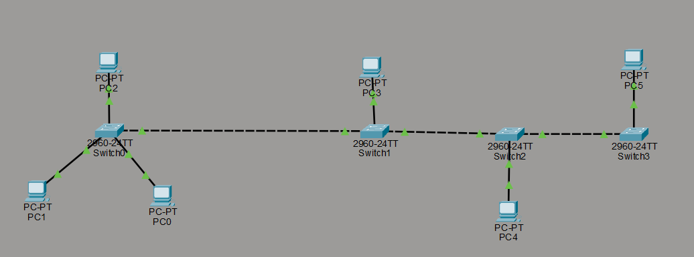

# Hybrid Network Topology

## Overview

A hybrid network topology combines two or more different network topologies, such as star, bus, ring, or mesh, into one network design.

It allows an organization to build a network based on its needs, size, and infrastructure.

## Network Diagram

The following image illustrates my hybrid network topology study.

## How Does a Hybrid Topology Work?

A hybrid topology combines different network layouts so that devices and network segments can communicate as part of a larger network.

The general process works as follows:

1. **Devices connect to their local network.** Computers, printers, and other devices connect through network equipment such as switches or access points.
2. **Network segments connect together.** Switches, routers, or other network devices connect different segments, depending on the network design.
3. **Data travels through the network.** Devices communicate within their local network or send traffic through a router when the destination is on another IP network.
4. **Traffic follows the appropriate path.** Network devices forward traffic according to their functions and configurations.
5. **The network can be expanded.** Additional segments or devices can be added when the design and available equipment support them.

The exact data path depends on the devices, connections, IP addressing, and configuration shown in the network diagram.

## Key Characteristics

- Combines two or more topology types.
- Supports flexible network design.
- Can connect multiple network segments.
- Can be expanded to meet changing requirements.
- May require more planning and maintenance than a simpler topology.

## Advantages

- **Flexibility:** Different areas can use different topology designs.
- **Scalability:** New devices or network segments can be added when needed.
- **Adaptability:** The design can suit different organizational requirements.
- **Potential resilience:** Redundant links or devices can provide alternative paths when designed appropriately.

## Disadvantages

- **Complexity:** Multiple topology types can make the network harder to understand and troubleshoot.
- **Cost:** Additional network devices and connections may be required.
- **Maintenance:** Configuration and monitoring can become more demanding.
- **Failure impact:** A failure in a central device or important connection may affect multiple network segments.

A hybrid topology does not automatically provide redundancy or security. These depend on the actual design and configuration.

## Why Is Hybrid Topology Relevant to Cybersecurity?

Understanding hybrid topology helps me learn how different network segments connect and how traffic moves between them.

This knowledge is useful when studying:

- Network segmentation.
- Firewall placement and access control.
- Network traffic monitoring.
- Network troubleshooting.
- Security boundaries between internal and external networks.

For example, an organization may separate employee devices, guest Wi-Fi, and internal servers into different network segments. Appropriate routing and security policies are needed to control communication between them.

## Learning Summary

A hybrid topology combines different network topologies into one design. It offers flexibility and can support network growth, but it may also increase cost and complexity.

The most important lesson is that understanding how network segments connect helps me understand how data moves and where network security controls may be applied.

## Next Step

My next step is to compare hybrid topology with star, mesh, and tree topologies and practise reading network diagrams.

---

*Learning how network designs work is part of building my networking and cybersecurity foundations.*
