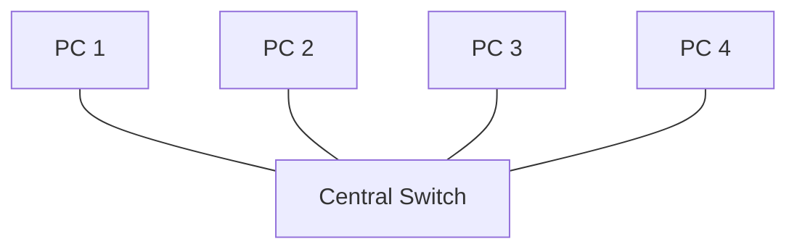
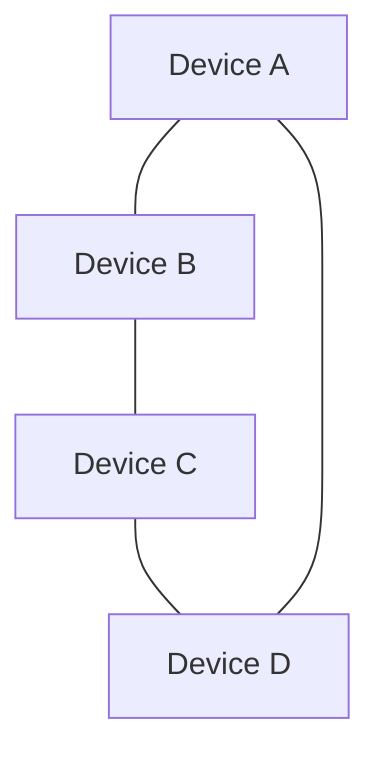
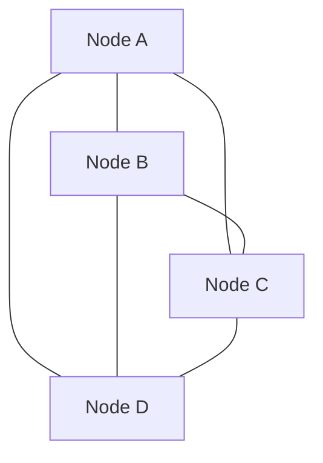
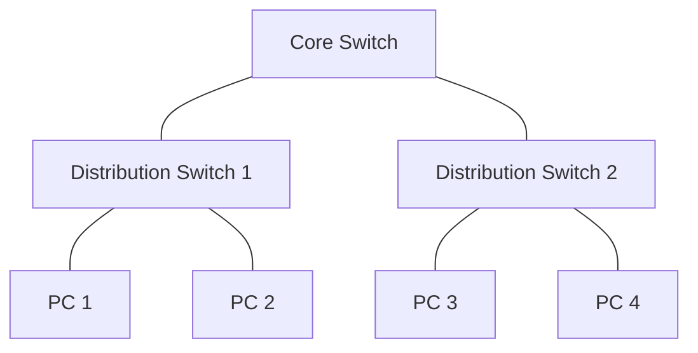

# Network Topology

## Overview

Network topology describes how devices and connections are arranged within a computer network. It can represent the physical layout of network devices or the logical way data moves between them.

Understanding network topology helps explain how devices communicate, how networks are designed, and how network failures can affect communication.

This document introduces common network topologies, their advantages and disadvantages, and their relevance to cybersecurity.

## 1. Types of Network Topology

### 1.1 Bus Topology

In a bus topology, devices connect to a shared main communication cable.

```text
[PC 1] ---- [PC 2] ---- [PC 3] ---- [PC 4]
                 Shared Cable
```

**Advantages**
- Requires relatively little cabling.
- Simple to understand for small, basic setups.

**Disadvantages**
- A failure in the main cable can disrupt the entire network.
- Performance can degrade as network traffic increases.
- Troubleshooting cable faults can be difficult.

### 1.2 Star Topology

In a star topology, each device connects to a central device, usually a switch in a wired LAN.



**Advantages**
- Easy to add or remove devices.
- A single endpoint cable failure usually affects only that device.
- Easier to troubleshoot than a shared-bus layout.

**Disadvantages**
- Failure of the central switch can disrupt connected devices.
- Requires a separate connection from each device to the central point.

### 1.3 Ring Topology

In a ring topology, each device connects to two neighboring devices, forming a closed loop.



**Advantages**
- Can provide orderly data transmission in some ring-based designs.
- May reduce collisions in networks using specific ring protocols.

**Disadvantages**
- A single link or device failure can disrupt a basic ring.
- Changes and troubleshooting can be more complicated.

Some ring technologies use redundancy or dual rings to improve resilience.

### 1.4 Mesh Topology

In a mesh topology, devices have multiple interconnections. A full mesh connects every device directly to every other device, while a partial mesh connects only selected devices.



**Advantages**
- Multiple paths can improve resilience.
- Alternative paths may keep communication available when a link fails.

**Disadvantages**
- Full mesh networks require many connections.
- Setup and maintenance can be more complex.
- Equipment and cabling costs may be higher.

### 1.5 Tree Topology

A tree topology organizes devices into hierarchical levels, often using a core, distribution, and access structure.



**Advantages**
- Supports structured network growth.
- Makes it easier to organize devices into groups.
- Can simplify network administration.

**Disadvantages**
- Failure of an important upstream device can affect an entire branch.
- Network design and configuration require planning.

### 1.6 Hybrid Topology

A hybrid topology combines two or more topology types in the same network.

For example, an office may use star topology inside individual departments and connect those departments through a hierarchical network.

**Advantages**
- Flexible design.
- Can accommodate different organizational requirements.
- Allows network segments to be designed for specific purposes.

**Disadvantages**
- Can be more complex to design and troubleshoot.
- Costs depend on the devices, links, and redundancy required.

## 2. Topology Comparison

| Topology | Main Advantage | Main Disadvantage |
|---|---|---|
| Bus | Simple shared layout | Main cable failure can affect all devices |
| Star | Easy to manage endpoints | Central device is a potential single point of failure |
| Ring | Orderly communication in certain designs | Basic ring can be disrupted by a failure |
| Mesh | Multiple communication paths | Higher cost and complexity |
| Tree | Structured and scalable | Upstream failures can affect branches |
| Hybrid | Flexible design | More complex to manage |

These are general characteristics. Actual behavior depends on the technology, redundancy, and network configuration.

## 3. Physical vs. Logical Topology

**Physical topology** describes how devices and cables are physically connected.

**Logical topology** describes how data flows between devices, which may differ from the physical layout.

For example, devices may be physically connected to switches in a star layout while logical network segmentation uses VLANs to separate traffic.

## 4. Why Network Topology Matters in Cybersecurity

Understanding network topology helps security practitioners:

- Identify important network devices and connections.
- Understand where network segmentation may be applied.
- Identify potential single points of failure.
- Understand how traffic may flow between network segments.
- Plan monitoring and security controls.
- Investigate network connectivity and security incidents.

A topology diagram can also help identify where firewalls, monitoring systems, and access control policies may be needed.

## 5. Practical Exercise

### Scenario

Imagine a small office with:

- 4 employee computers.
- 1 network printer.
- 1 central switch.
- 1 router connected to the internet.

### Tasks

1. Draw a network topology diagram for the office.
2. Identify which device acts as the central connection point.
3. Explain what could happen if the central switch fails.
4. Suggest one improvement to make the network more resilient.
5. Explain how the office could separate guest devices from internal devices.

Record your diagram, reasoning, and observations in this repository.

## Learning Outcome

After studying this topic, I aim to identify common network topologies, compare their advantages and disadvantages, and understand how topology affects network reliability, troubleshooting, and security design.

My next step is to practise creating simple network diagrams and explore how network devices communicate within a local area network.

## References

- [Cisco — Networking Basics](https://www.cisco.com/)
- [Mermaid Documentation — Getting Started](https://mermaid.js.org/intro/)

---

*Understanding how networks are connected is a foundation for understanding how to secure them.*
