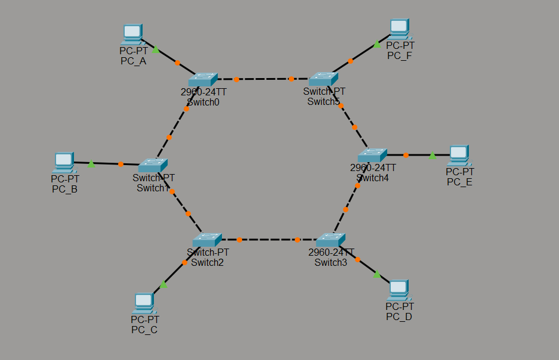

# Ring Topology

## 1. Overview

Ring topology is a network topology in which each device is connected to two neighboring devices, forming a circular structure. Data travels from one device to another around the ring until it reaches its destination.

## 2. Network Diagram

*Figure 1. A visual representation of Ring Topology.*

## 3. How It Works

1. **Data transmission:** A device sends data through the network to reach the intended destination.
2. **Device-to-device forwarding:** Data passes from one connected device to the next around the ring.
3. **Destination identification:** Each device checks whether the data is intended for it. If not, the data continues to the next device.
4. **Data delivery:** The data reaches the destination device and is received.

The direction and method of data transmission depend on the specific ring network implementation. Some ring networks use token passing to control which device can transmit data.

## 4. Advantages

- **Organized data transmission:** Some ring implementations use controlled access methods to reduce data collisions.
- **Predictable traffic flow:** Data follows an established path through the ring.
- **Equal access opportunities:** In token-based systems, devices can take turns transmitting data.

## 5. Disadvantages

- **Link or device failure:** In a basic single-ring network, a failed link or device can disrupt communication across the ring.
- **Troubleshooting complexity:** Identifying the source of a network failure may require checking multiple connections.
- **Limited scalability:** Adding or removing devices can disrupt communication, depending on the implementation.

## 6. Common Use Cases

Ring topology has been used in token-based local area networks and is also found in some fiber-optic and metropolitan network designs that use ring protection mechanisms.

## 7. Key Takeaway

Ring topology connects devices in a circular path, allowing data to travel from one device to another around the network. Its reliability depends on the design: a basic single ring is vulnerable to certain failures, while protected or dual-ring implementations can provide greater resilience.
