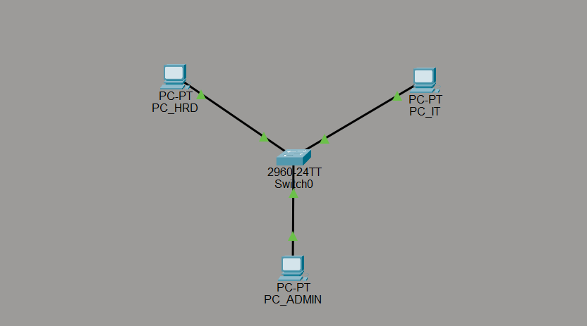

# Star Topology

## 1. Overview

Star topology is a network topology in which all devices connect to a central device, such as a switch or hub. Devices communicate with each other through this central device rather than connecting directly to one another.

## 2. Network Diagram

*Figure 1. A visual representation of Star Topology.*

## 3. How It Works

1. **Data transmission:** A device sends data to the central switch or hub.
2. **Central device processing:** The central device handles the incoming data.
3. **Data forwarding:** A switch forwards the data to the intended destination port. A hub, in contrast, broadcasts incoming data to all other connected ports.
4. **Data delivery:** The destination device receives the data.

## 4. Advantages

- **Easy to manage:** Devices and connections can be managed from a central point.
- **Simple troubleshooting:** A faulty cable or device usually affects only the connected device.
- **Easy to expand:** New devices can be added by connecting them to the central device.
- **Better performance with switches:** A switch can forward traffic to the appropriate destination port, reducing unnecessary traffic compared with a hub.

## 5. Disadvantages

- **Central point of failure:** If the central switch or hub fails, communication between connected devices is disrupted.
- **More cabling required:** Each device needs a separate connection to the central device.
- **Additional equipment cost:** A central switch or hub is required to connect the devices.

## 6. Common Use Cases

Star topology is commonly used in home networks, office LANs, school computer labs, and other Ethernet networks where devices connect to a central switch or router.

## 7. Key Takeaway

Star topology connects every device to a central device that manages network communication. It is easy to maintain, troubleshoot, and expand, but its reliability depends heavily on the central device.
