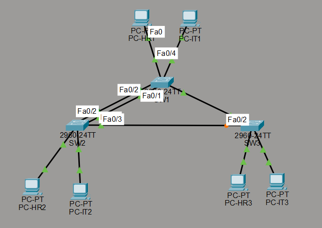

# Spanning Tree Protocol (STP) with EtherChannel and VLANs

A Cisco Packet Tracer lab that demonstrates loop prevention and failover using STP, LACP EtherChannel, and VLAN trunking across three switches.

## Objectives

- Configure VLANs 10 (HR) and 20 (IT) and trunk links across 3 switches
- Bundle two links between SW1 and SW2 with LACP EtherChannel
- Make SW1 the Root Bridge
- Observe STP blocking a redundant link to prevent loops
- Demonstrate reconvergence when the Root Port fails

## Topology

## Addressing

| Device | VLAN | IP Address |
|--------|------|------------|
| PC-HR1 | 10 (HR) | 192.168.10.11/24 |
| PC-HR2 | 10 (HR) | 192.168.10.12/24 |
| PC-HR3 | 10 (HR) | 192.168.10.13/24 |
| PC-IT1 | 20 (IT) | 192.168.20.11/24 |
| PC-IT2 | 20 (IT) | 192.168.20.12/24 |
| PC-IT3 | 20 (IT) | 192.168.20.13/24 |

## Cabling

| From | To | Purpose |
|------|----|---------|
| SW1 Fa0/1-2 | SW2 Fa0/1-2 | LACP EtherChannel (Port-channel 1) |
| SW1 Fa0/3 | SW3 Fa0/1 | Trunk |
| SW2 Fa0/3 | SW3 Fa0/2 | Trunk (blocked by STP on the SW3 side) |

End devices connect with their FastEthernet0 port to access ports: SW1 Fa0/4-5, SW2 Fa0/4-5, SW3 Fa0/3-4.

## Results

### Setup verification

| Check | Screenshot |
|-------|------------|
| EtherChannel is up (Po1 = SU, Fa0/1 and Fa0/2 = P) | [01-etherchannel-summary](screenshots/01-etherchannel-summary.png) |
| VLAN 10 and 20 exist, access ports assigned correctly | [02-show-vlan-brief](screenshots/02-show-vlan-brief.png) |

### Demo 1: STP prevents loops

SW1 is the Root Bridge. On SW3, Fa0/1 (direct to SW1, cost 19) is the Root Port and forwards, while Fa0/2 (towards SW2) is the Alternate Port and is blocked. This leaves only one active path and no loop.

| Check | Screenshot |
|-------|------------|
| SW1 is the Root Bridge | [03-stp-vlan10-sw1](screenshots/03-stp-vlan10-sw1.png) |
| SW2 port roles | [04-stp-vlan10-sw2](screenshots/04-stp-vlan10-sw2.png) |
| SW3: Fa0/1 Root FWD, Fa0/2 Altn BLK | [05-stp-vlan10-sw3-before](screenshots/05-stp-vlan10-sw3-before.png) |
| Ping between PCs in the same VLAN succeeds | [06-ping-same-vlan](screenshots/06-ping-same-vlan.png) |

### Demo 2: Reconvergence after link failure

Fa0/1 on SW3 (the Root Port) was shut down. STP recalculated and the blocked Fa0/2 became the new Root Port, so SW3 reaches the Root Bridge through SW2. Ping from PC-HR3 to PC-HR1 still succeeded. After `no shutdown`, the topology returned to its original state.

| Step | Screenshot |
|------|------------|
| After shutdown: Fa0/2 is now Root FWD | [07-stp-vlan10-sw3-after-shutdown](screenshots/07-stp-vlan10-sw3-after-shutdown.png) |
| Ping PC-HR3 to PC-HR1 during failover | [08-ping-during-failover](screenshots/08-ping-during-failover.png) |
| After `no shutdown`: back to the original state | [09-stp-vlan10-sw3-restored](screenshots/09-stp-vlan10-sw3-restored.png) |

## Key Takeaways

- STP keeps a redundant link blocked so the network stays loop-free, while traffic still flows normally.
- EtherChannel merges two physical links into one logical link, so STP treats it as a single path.
- When the active path fails, STP unblocks the backup path automatically and connectivity recovers without manual changes.
- Without a router, only PCs in the same VLAN can communicate.

## Files

| Item | Location |
|------|----------|
| SW1 configuration | [configs/SW1-config.txt](configs/SW1-config.txt) |
| SW2 configuration | [configs/SW2-config.txt](configs/SW2-config.txt) |
| SW3 configuration | [configs/SW3-config.txt](configs/SW3-config.txt) |
| Packet Tracer file | [topology/stp-lab.pkt](topology/stp-lab.pkt) |
| Step-by-step guide | [docs/lab-guide.md](./docs/lab-guide.md) |
| Troubleshooting notes | [docs/troubleshooting.md](./docs/troubleshooting.md) |
