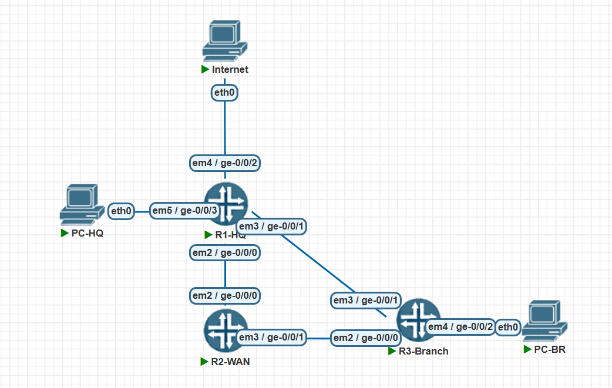

# Static Routing & OSPF Lab (Junos on PNETLab)

## Overview
This lab connects an HQ site and a Branch site, first with static routes and then
with OSPF, and observes how the network reroutes when a link fails.
It is based on the Session 5 Lab Guide (Static Routing & OSPF).

## Topology

- IP plan: [topology/ip-addressing-plan.md](topology/ip-addressing-plan.md)
- Interface names: [topology/interface-mapping.md](topology/interface-mapping.md)

## Tools
- PNETLab
- Juniper vMX (3 routers: R1-HQ, R2-WAN, R3-Branch)
- VPCS (3 hosts: PC-HQ, PC-BR, Internet-Host)

## Phases
| Phase | Topic             | Config                                                               | Proof                                                                          |
|-------|-------------------|----------------------------------------------------------------------|--------------------------------------------------------------------------------|
| 0     | Base config       | [configs/phase0-base](configs/phase0-base)                           | [verification/phase0-base.md](verification/phase0-base.md)                     |
| 1     | Static routing    | [configs/phase1-static-routing](configs/phase1-static-routing)       | [verification/phase1-static-routing.md](verification/phase1-static-routing.md) |
| 2     | OSPF              | [configs/phase2-ospf](configs/phase2-ospf)                           | [verification/phase2-ospf.md](verification/phase2-ospf.md)                     |
| 3     | Cost and failover | [configs/phase3-cost-and-failover](configs/phase3-cost-and-failover) | [verification/phase3-failover.md](verification/phase3-failover.md)             |

## Key Results
Fill in after each phase (example: "OSPF: every router shows 2 neighbors in Full state").

- Phase 0: _TBD_
- Phase 1: _TBD_
- Phase 2: _TBD_
- Phase 3: _TBD_

## Lessons Learned
See [docs/troubleshooting.md](docs/troubleshooting.md) and [docs/answers.md](docs/answers.md).
