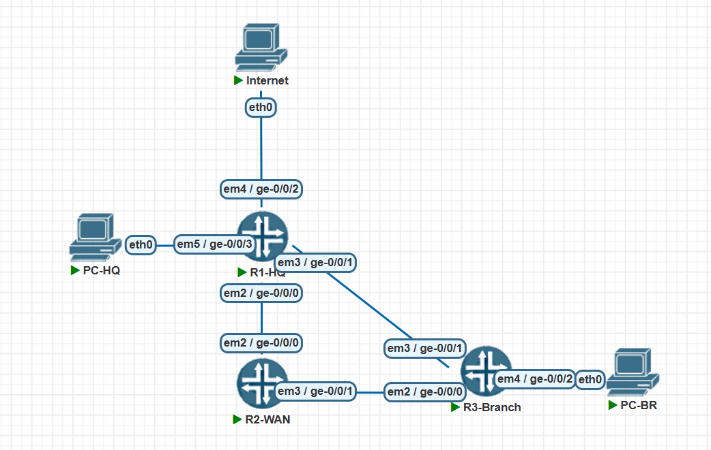

# Interface Mapping & Topology Wiring

## 1. Point-to-Point Connection Matrix

All router interconnections and LAN uplinks in **PNETLab** use Juniper vMX data-plane interfaces (`ge-0/0/0` through `ge-0/0/3`).

| Link ID | Segment Description | Local Device | Local Interface | Remote Device | Remote Interface | OSPF Status (Phase 2–3) |
| :--- | :--- | :--- | :--- | :--- | :--- | :--- |
| **L1** | HQ – WAN Transit | `R1` | `ge-0/0/0.0` | `R2` | `ge-0/0/0.0` | Active (`Area 0.0.0.0`) |
| **L2** | HQ – Branch Direct | `R1` | `ge-0/0/1.0` | `R3` | `ge-0/0/1.0` | Active (`Area 0.0.0.0`, `metric 100` in Phase 3) |
| **L3** | WAN – Branch Transit | `R2` | `ge-0/0/1.0` | `R3` | `ge-0/0/0.0` | Active (`Area 0.0.0.0`) |
| **L4** | HQ Local Area Network | `R1` | `ge-0/0/3.0` | `PC-HQ` | `eth0` | Passive (`Area 0.0.0.0`) |
| **L5** | Branch Local Area Network | `R3` | `ge-0/0/2.0` | `PC-BR` | `eth0` | Passive (`Area 0.0.0.0`) |
| **L6** | External / Internet Uplink | `R1` | `ge-0/0/2.0` | `Internet-Host` | `eth0` | Excluded (Static default route exported) |

---

## 2. Per-Router Interface Summary

### R1 (HQ Edge Router — Juniper vMX)
- `ge-0/0/0.0`: Transit link to **R2** (`ge-0/0/0.0`)
- `ge-0/0/1.0`: Direct transit link to **R3** (`ge-0/0/1.0`)
- `ge-0/0/2.0`: External uplink to **Internet-Host** (`eth0`)
- `ge-0/0/3.0`: Gateway interface for **HQ LAN** (`PC-HQ`)
- `lo0.0`: Loopback interface for OSPF Router ID

### R2 (WAN Transit Router — Juniper vMX)
- `ge-0/0/0.0`: Transit link to **R1** (`ge-0/0/0.0`)
- `ge-0/0/1.0`: Transit link to **R3** (`ge-0/0/0.0`)
- `lo0.0`: Loopback interface for OSPF Router ID

### R3 (Branch Router — Juniper vMX)
- `ge-0/0/0.0`: Transit link to **R2** (`ge-0/0/1.0`)
- `ge-0/0/1.0`: Direct transit link to **R1** (`ge-0/0/1.0`)
- `ge-0/0/2.0`: Gateway interface for **Branch LAN** (`PC-BR`)
- `lo0.0`: Loopback interface for OSPF Router ID

> **PNETLab Wiring Note:** Do not connect lab links to `fxp0` or `em1` on Juniper vMX nodes, as those interfaces are reserved for out-of-band management and internal VCP–VFP control-plane communication.
