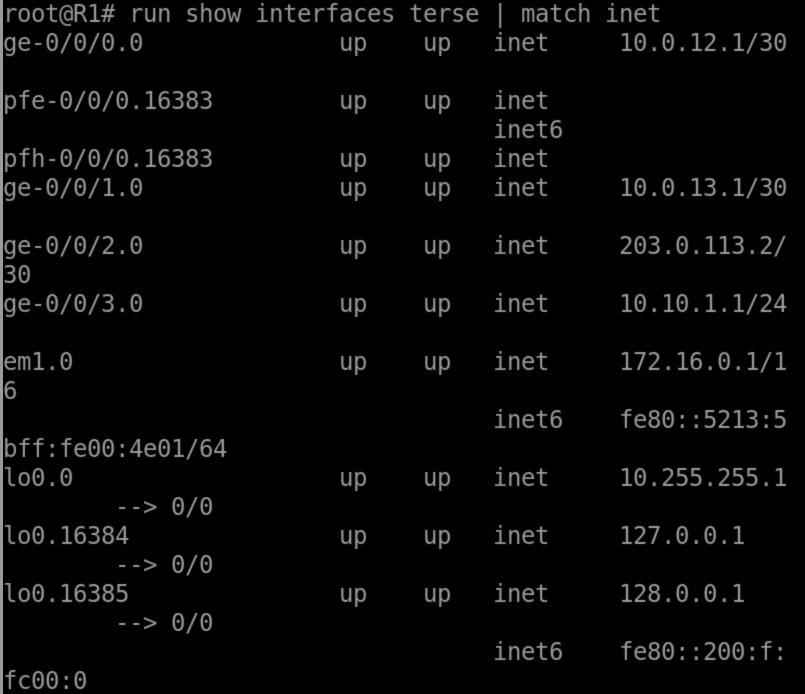
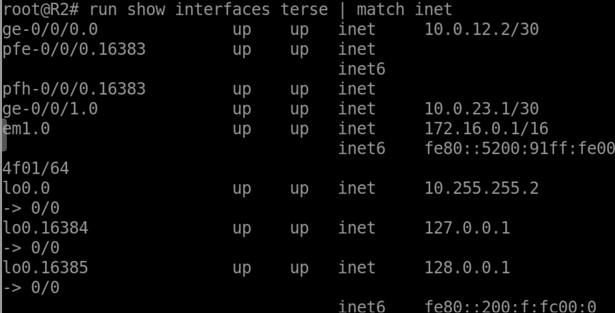
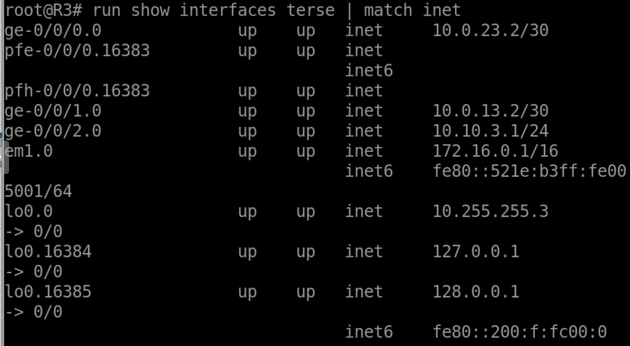
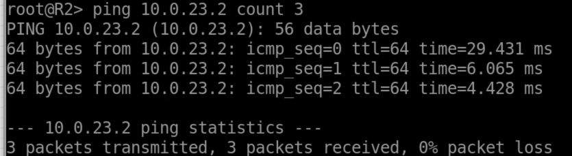
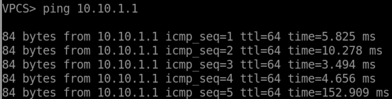
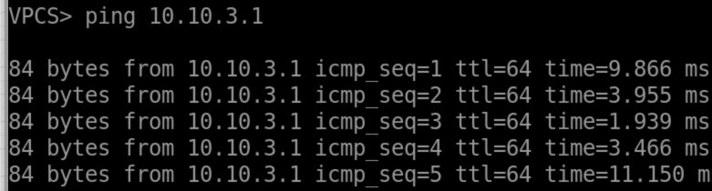
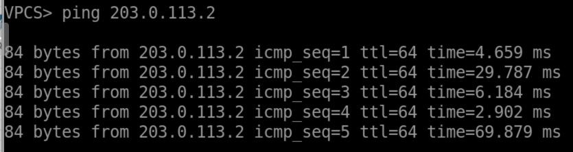
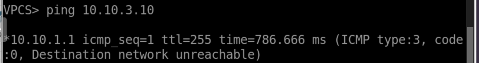
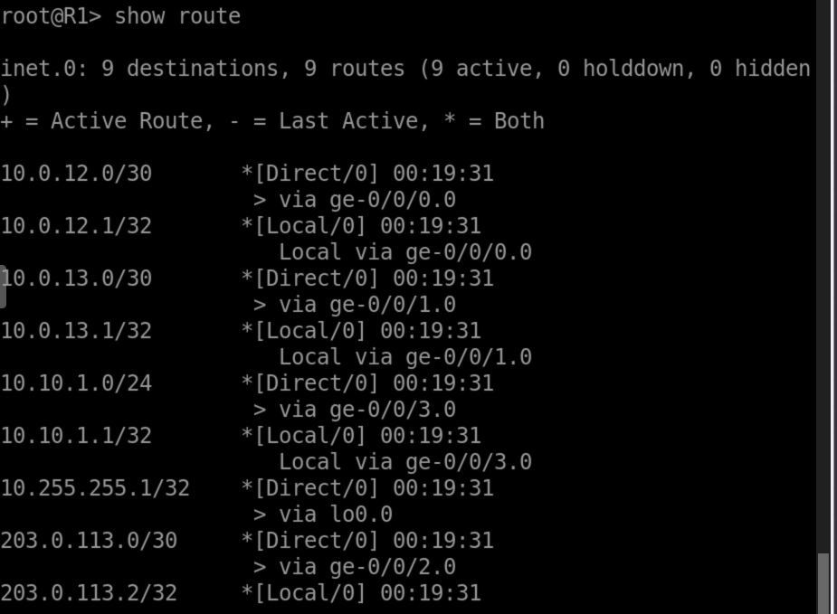

# Phase 0 - Base Config: Verification

Goal: every router has a hostname and interface addresses, and direct neighbors can ping each other.

## 1. Interface addresses
Command (on R1, R2, R3): `show interfaces terse | match inet`

## 2. Router-to-router ping
R1: `ping 10.0.12.2 count 3` and `ping 10.0.13.2 count 3`

R2: `ping 10.0.23.2 count 3`

## 3. Host-to-gateway ping

- **PC-HQ:** `ping 10.10.1.1`

  

- **PC-BR:** `ping 10.10.3.1`

  

- **Internet-Host:** `ping 203.0.113.2`

  
  
## 4. Expected failure: PC-HQ -> PC-BR
`ping 10.10.3.10` from PC-HQ fails.

## 5. Routing table on R1
Command: `show route`

## Result
- [ ] All interfaces up with correct addresses
- [ ] Direct neighbors reply to ping
- [ ] Hosts reach their gateways
- [ ] PC-HQ cannot reach PC-BR (expected)
