# Phase 1: Static Routing Verification

## Objective
Configure static routes on **R1 (HQ)** and **R3 (Branch)** to establish end-to-end connectivity between the HQ LAN (`10.10.1.0/24`) and Branch LAN (`10.10.3.0/24`) over the direct link (`R1` → `R3`), configure a default route to the Internet host on R1, and observe static routing behavior during a link failure.

---

## 1. One-Way Static Route Observation (Before Return Route)
After configuring the forward static route on R1 (`10.10.3.0/24` via `10.0.13.2`), ICMP echo requests from PC-HQ reach PC-BR, but replies fail because R3 lacks a return route to `10.10.1.0/24`.

- **PC-HQ:** `ping 10.10.3.10` (Request timed out)

  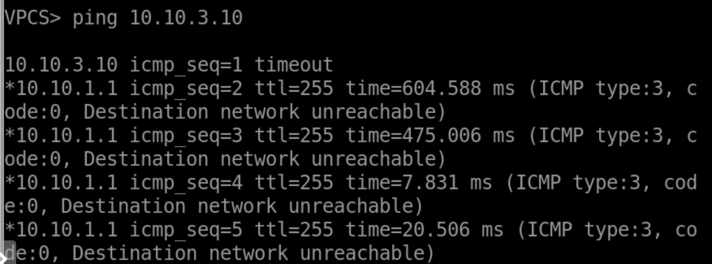

- **R3:** `show route 10.10.1.0/24` (No route entry)

  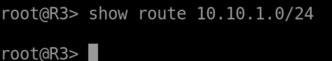

---

## 2. Routing Table Verification
After adding the return route on R3 (`10.10.1.0/24` via `10.0.13.1`) and the default route on R1 (`0.0.0.0/0` via `203.0.113.1`), both routers install the static routes with Junos default route preference **5**.

- **R1:** `show route`

  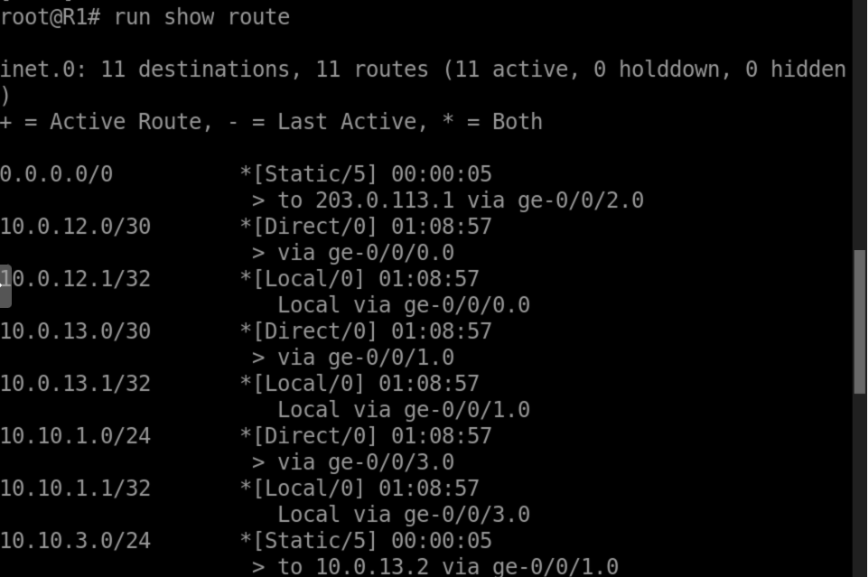

- **R3:** `show route`

  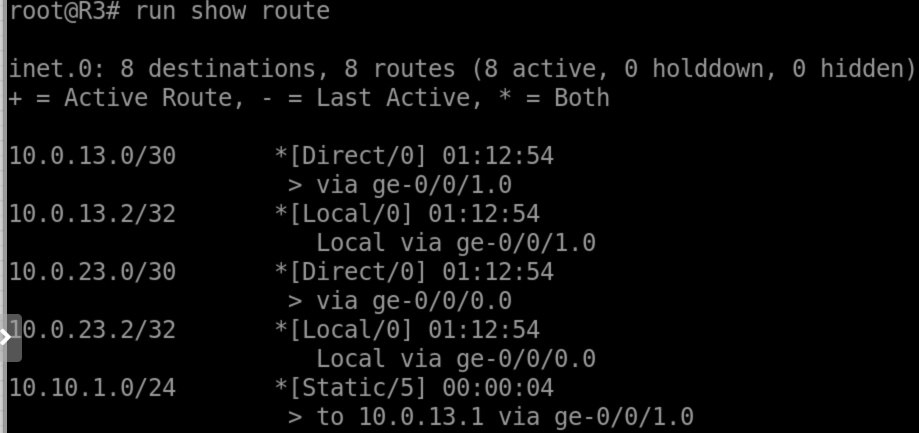

---

## 3. Site-to-Site Reachability & Path Verification
With bidirectional static routes in place, PC-HQ successfully reaches PC-BR over the direct R1–R3 link.

- **PC-HQ:** `ping 10.10.3.10` and `trace 10.10.3.10`
- **Expected Trace Path:** `10.10.1.1` → `10.0.13.2` → `10.10.3.10`

  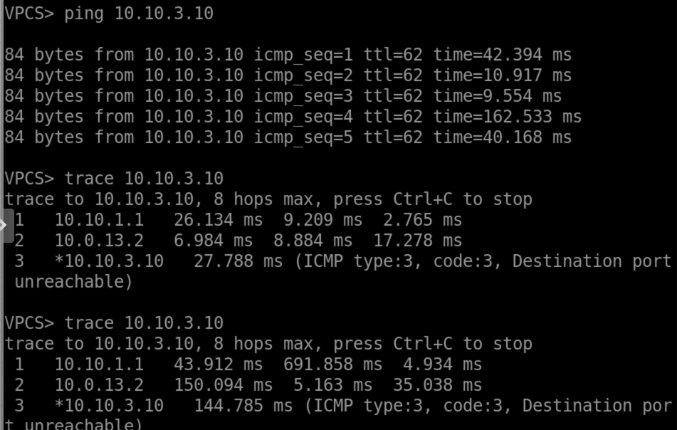

---

## 4. Internet Reachability Verification
R1 forwards unknown traffic to the Internet host (`203.0.113.1`). PC-HQ can reach the Internet host, whereas PC-BR cannot because R3 does not have a default route configured.

- **PC-HQ:** `ping 203.0.113.1` (Success)

  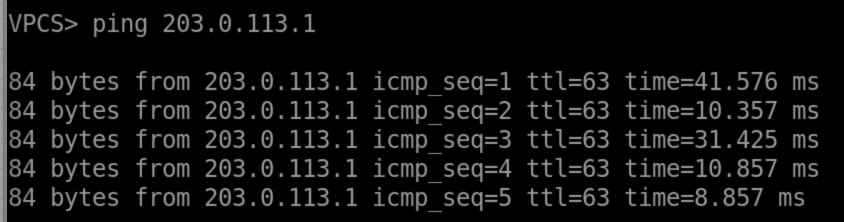

- **PC-BR:** `ping 203.0.113.1` (Destination unreachable / Timeout)

  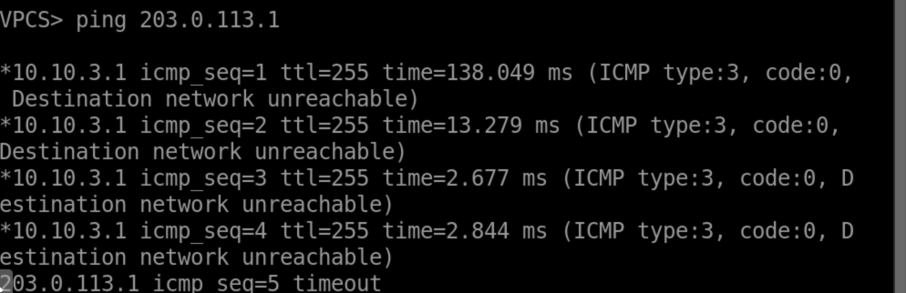

---

## 5. Direct Link Failure & Recovery Test
A continuous ping (`ping 10.10.3.10 -t`) was started on PC-HQ while interface `ge-0/0/1` on R1 was disabled (`set interfaces ge-0/0/1 disable`).

- **R1 (Disable Link):** `set interfaces ge-0/0/1 disable` and `commit`

  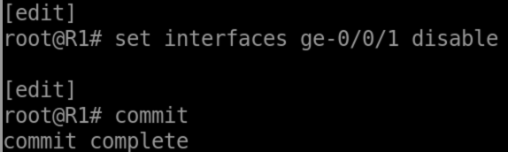

- **PC-HQ (Failure Observation):** Traffic stopped immediately and did not fail over to the backup path via R2 (`10.0.12.0/30` – `10.0.23.0/30`) because static routes do not dynamically detect path failures or recalculate routes.

  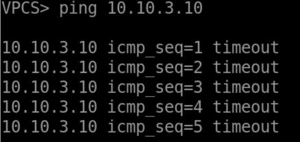

- **R1 (Restore Link):** `delete interfaces ge-0/0/1 disable` and `commit`

  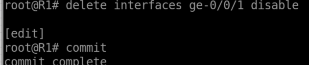

- **PC-HQ (Recovery Observation):** Connectivity resumed only after manually re-enabling `ge-0/0/1` on R1.

  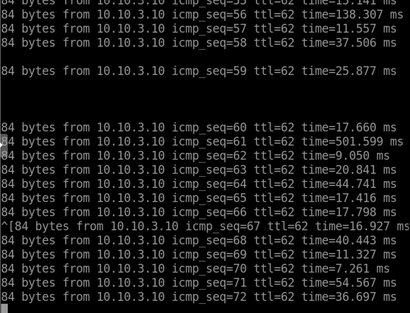

---

## 6. Verification Checklist & Lab Analysis

| Verification Item | Expected Result | Status |
| :--- | :--- | :---: |
| Bidirectional ping (`PC-HQ` ↔ `PC-BR`) | Succeeds over direct R1–R3 link | Pass |
| Traceroute (`PC-HQ` → `10.10.3.10`) | Hops: `10.10.1.1` → `10.0.13.2` → `10.10.3.10` | Pass |
| Static route preference on R1 & R3 | Preference `5` (`[Static/5]`) | Pass |
| Internet reachability from `PC-HQ` | `ping 203.0.113.1` succeeds | Pass |
| Internet reachability from `PC-BR` | `ping 203.0.113.1` fails (no default route on R3) | Pass |
| Link failure failover (`ge-0/0/1` disabled) | Traffic drops; no automatic reroute via R2 | Pass |

### Lab Question Answer
> **Question:** *How many static routes would you need if this company had 10 branches, and who updates them when a link fails?*

- **Number of Static Routes:** With 1 HQ and 10 branches (11 sites total), achieving full-mesh site-to-site connectivity requires $11 \times 10 = 110$ static routes across all routers (or $220$ routes if floating static backup routes via R2 are added). Even in a strict hub-and-spoke design where branches only communicate with HQ, HQ requires 10 static routes and each branch requires at least 1 route (a minimum of 20 static routes, excluding backup paths).
- **Maintenance on Link Failure:** A **network administrator** must manually log into the affected routers and update or re-point the static routes whenever a link fails or topology changes, because static routing lacks neighbor discovery and automatic convergence.
