# Phase 2 - OSPF: Verification

**Goal:** replace the site-to-site static routes with OSPF (area 0) and keep the static
default route on R1. After this phase the routers learn the HQ and Branch LANs from each
other automatically, and R1 shares its default route with the rest of the network.

## OSPF design

| Router | Router ID    | OSPF interfaces        | Passive interfaces |
|--------|--------------|------------------------|--------------------|
| R1     | 10.255.255.1 | ge-0/0/0.0, ge-0/0/1.0 | ge-0/0/3.0, lo0.0  |
| R2     | 10.255.255.2 | ge-0/0/0.0, ge-0/0/1.0 | lo0.0              |
| R3     | 10.255.255.3 | ge-0/0/0.0, ge-0/0/1.0 | ge-0/0/2.0, lo0.0  |

- **Passive** interfaces (LANs and loopbacks) are advertised in OSPF but send no Hello packets.
- R1 `ge-0/0/2.0` (link to the Internet host) is intentionally **not** in OSPF.

Full configs: [`../configs/phase2-ospf/`](../configs/phase2-ospf/)

---

## Step 1 - Static routes removed

Removed the site-to-site static routes (`10.10.3.0/24` on R1, `10.10.1.0/24` on R3).
The default route on R1 stays.

```
root@R1# delete routing-options static route 10.10.3.0/24
root@R1# commit
commit complete
root@R1# run show route protocol static

0.0.0.0/0          *[Static/5] 00:07:46
                    > to 203.0.113.1 via ge-0/0/2.0
```

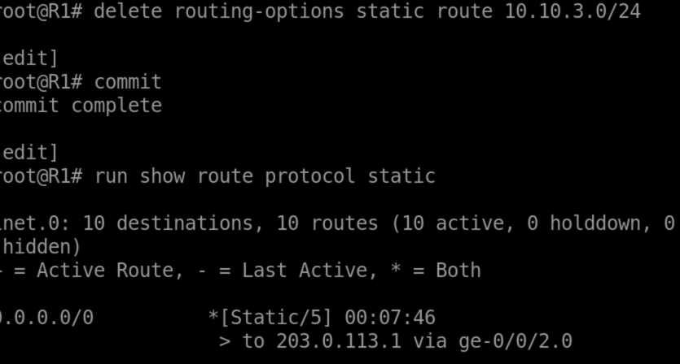

**What this proves:** only the default route is still static. Any connectivity between
the HQ and Branch LANs from now on must come from OSPF.

---

## Step 2 - OSPF configuration

Command on each router: `run show configuration protocols ospf`

**R1**
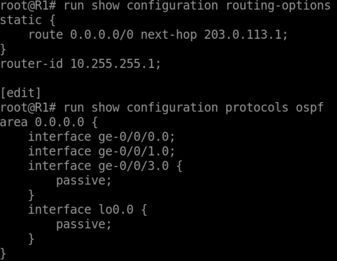

**R2**
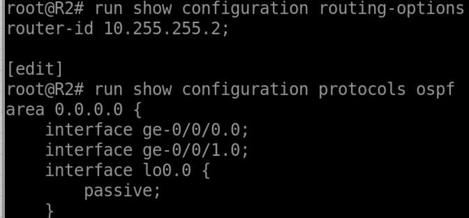

**R3**
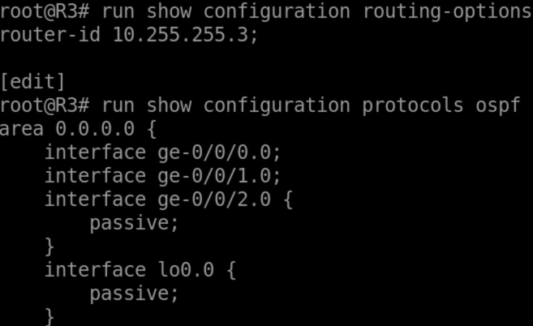

**What this proves:** each router runs OSPF in area 0.0.0.0 on its inter-router links,
with LAN and loopback interfaces set to passive.

---

## Step 3 - Neighbors and learned routes

### OSPF neighbors

Command on each router: `run show ospf neighbor`

R1 result:

```
Address         Interface       State   ID             Pri  Dead
10.0.12.2       ge-0/0/0.0      Full    10.255.255.2   128  35
10.0.13.2       ge-0/0/1.0      Full    10.255.255.3   128  39
```

**R1**
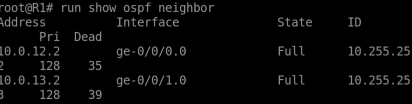

**R2**
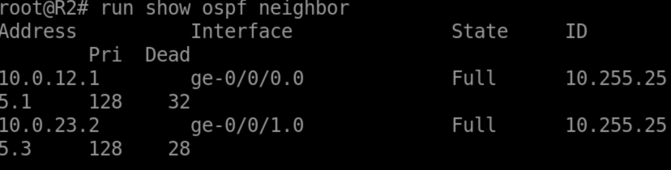

**R3**
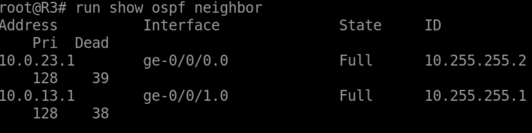

**What this proves:** every router has two neighbors in state `Full`, meaning the Hello
exchange worked and the routers have synchronized their link-state databases.

### Routes learned through OSPF

Command on R1: `run show route protocol ospf`

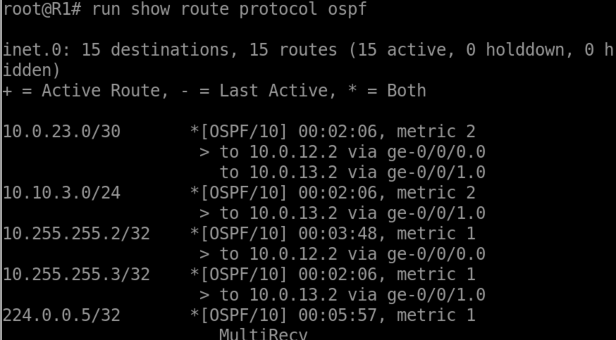

**What this proves:** R1 now learns `10.10.3.0/24` (Branch LAN) through OSPF with
preference 10, without any static route.

### End-to-end test

Commands on PC-HQ: `ping 10.10.3.10` and `trace 10.10.3.10`

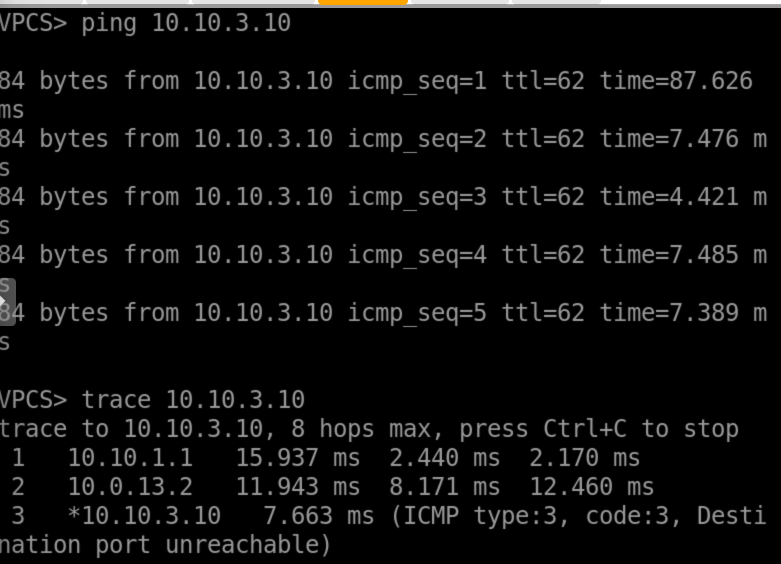

**What this proves:** HQ reaches Branch again. The path is
`10.10.1.1 -> 10.0.13.2 -> 10.10.3.10` (the direct R1-R3 link has the lowest cost).

---

## Step 4 - Default route distributed into OSPF

On R1 (the only router with a static default route), the policy `EXPORT-DEFAULT`
exports exactly `0.0.0.0/0` from static into OSPF.

Commands on R1:
`run show configuration policy-options` and `run show configuration protocols ospf`

```
policy-statement EXPORT-DEFAULT {
    term 1 {
        from {
            protocol static;
            route-filter 0.0.0.0/0 exact;
        }
        then accept;
    }
}

export EXPORT-DEFAULT;
```

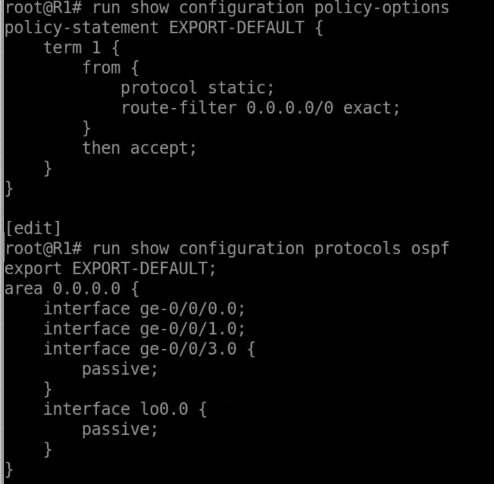

**What this proves:** the policy is applied to OSPF (`export EXPORT-DEFAULT;`) and only
the default route is shared.

### Default route learned on R3

Command on R3: `run show route 0.0.0.0/0`

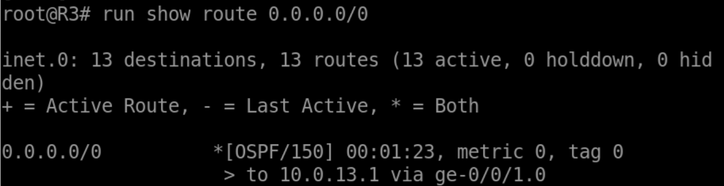

**What this proves:** R3 learns the default route from OSPF as an external route
(preference 150), so it no longer needs a static default route.

### Branch to Internet

Command on PC-BR: `ping 203.0.113.1`

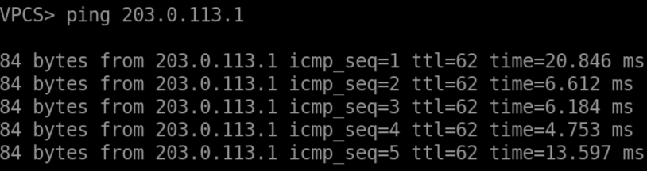

**What this proves:** a Branch host can reach the Internet host through R3 and R1.

---

## Result checklist

Tick each box once the matching screenshot shows the expected result.

- [x] Static routes between the sites removed; only the default route remains on R1
- [x] R1 shows 2 OSPF neighbors in state Full
- [ ] R2 shows 2 OSPF neighbors in state Full
- [ ] R3 shows 2 OSPF neighbors in state Full
- [ ] `show route protocol ospf` on R1 lists 10.10.3.0/24 with preference 10
- [ ] PC-HQ pings PC-BR (path through the direct link)
- [x] R1 exports the default route into OSPF (`EXPORT-DEFAULT`)
- [ ] `show route 0.0.0.0/0` on R3 shows an OSPF route with preference 150
- [ ] PC-BR pings 203.0.113.1

---

## Question: compare the lines typed for OSPF with Phase 1. What changes with a fourth site?

**Phase 1 (static):** every remote LAN needs a route entry on every router that must reach
it, in both directions. A fourth site means editing several existing routers, and when a
link fails someone has to fix the routes by hand.

**Phase 2 (OSPF):** each router needs the same few lines no matter how many sites exist
(router-id, OSPF interfaces, passive LANs). With a fourth site, only the new router gets
the full OSPF configuration. The routers it connects to just enable OSPF on the new link.
The new LAN is then learned and advertised automatically, and routes are recalculated on
their own when a link fails.
