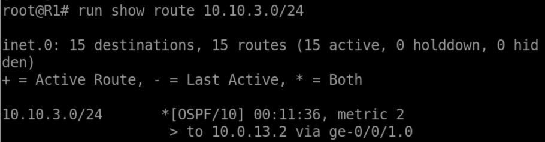
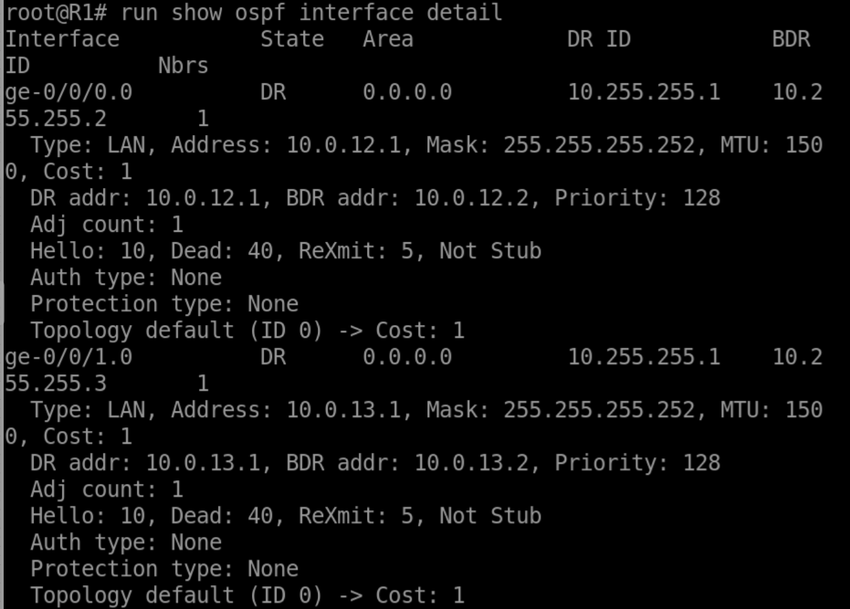
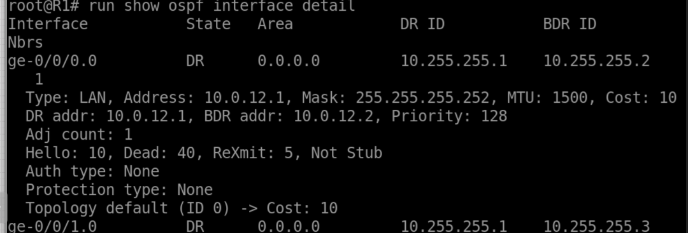
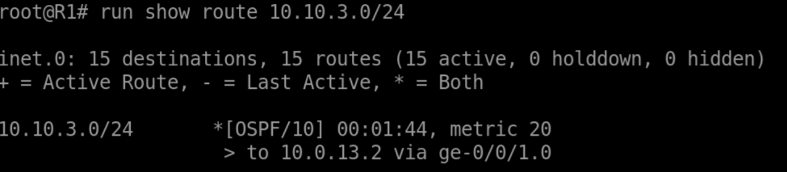
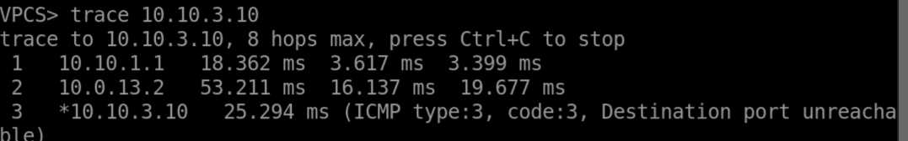
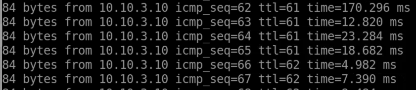
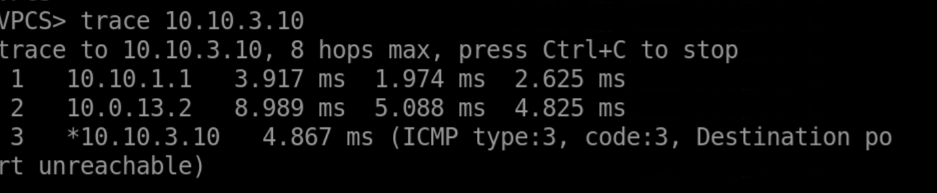
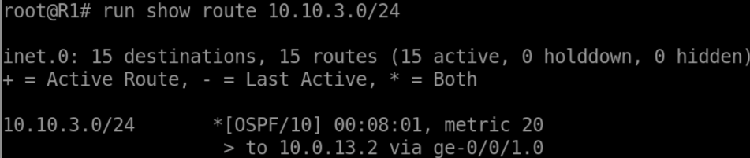
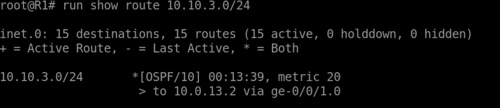

# Phase 3: OSPF Cost Manipulation & Failover Verification

## Objective
Observe default OSPF path selection and interface cost calculation, adjust the OSPF `reference-bandwidth` to `10g`, steer site-to-site traffic through **R2 (WAN)** by raising the metric on the direct **R1–R3** link, and verify automatic OSPF failover and recovery during a transit link failure.

---

## 1. Initial OSPF Path Selection & Default Interface Cost
By default, OSPF uses a reference bandwidth of 100 Mbps, assigning a cost of **1** to every interface. Consequently, R1 selects the direct link to R3 (`10.0.13.2`) over the two-hop path via R2.

- **R1:** `show route 10.10.3.0/24` (Next-hop `10.0.13.2` via `ge-0/0/1.0`)

  

- **R1:** `show ospf interface detail` (Default interface cost `1`)

  

---

## 2. Reference Bandwidth Adjustment (`10g`)
After setting `reference-bandwidth 10g` across R1, R2, and R3, OSPF recalculates interface costs proportionally based on link bandwidth rather than treating all links identically.

- **R1:** `show ospf interface detail` (Updated higher interface cost)

  

---

## 3. Traffic Engineering via R2 (Metric Manipulation)
Raising the OSPF metric to **100** on both ends of the direct R1–R3 link (`ge-0/0/1.0`) makes the two-hop path through R2 lower in total cost, steering site-to-site traffic via R2.

- **R1:** `show route 10.10.3.0/24` (Next-hop switched to `10.0.12.2` via `ge-0/0/0.0`)

  

- **PC-HQ:** `trace 10.10.3.10` (Path: `10.10.1.1` → `10.0.12.2` → `10.0.23.2` → `10.10.3.10`)

  

---

## 4. Automatic Link Failure Failover & Recovery Test
While running a continuous ping (`ping 10.10.3.10 -t`) on PC-HQ, the transit link between R2 and R3 was disabled on R2 (`set interfaces ge-0/0/1 disable`).

- **R2 (Break Primary Path):** `set interfaces ge-0/0/1 disable` and `commit`

  

- **PC-HQ (Continuous Ping Observation):** Traffic experienced only brief packet loss during OSPF reconvergence before automatically resuming.

  

- **PC-HQ (Failover Traceroute):** `trace 10.10.3.10` confirms traffic automatically rerouted over the direct R1–R3 backup path (`10.10.1.1` → `10.0.13.2` → `10.10.3.10`).

  

- **R1 (Failover Routing Table):** `show route 10.10.3.0/24` shows next-hop `10.0.13.2` with the higher path cost (`100`+).

  

- **R1 (Recovery Observation):** After re-enabling `ge-0/0/1` on R2 (`delete interfaces ge-0/0/1 disable` and `commit`), OSPF restored the R2–R3 adjacency and automatically returned traffic to the preferred lower-cost path via `10.0.12.2`.

  

---

## 5. Verification Checklist & Lab Comparison

| Verification Item | Expected Result | Status |
| :--- | :--- | :---: |
| Initial OSPF path (`10.10.3.0/24`) | Selects direct link `10.0.13.2` (cost `1`) | Pass |
| Reference bandwidth (`10g`) update | Interface cost increases proportionally from `1` | Pass |
| Traffic steering (`metric 100` on `ge-0/0/1.0`) | `show route` & `trace` shift to `10.0.12.2` (R2) | Pass |
| Automatic failover (`R2 ge-0/0/1` disabled) | Brief drop, then reroutes via `10.0.13.2` | Pass |
| Automatic recovery (`R2 ge-0/0/1` re-enabled) | Traffic returns to preferred path `10.0.12.2` | Pass |

### Phase 1 vs. Phase 3 Failover Comparison
- **Phase 1 (Static Routing):** When the primary link (`R1`–`R3`) failed, connectivity stopped completely and never recovered until an administrator manually intervened, even though a healthy physical path through R2 existed[cite: 8].
- **Phase 3 (OSPF Dynamic Routing):** When the primary path through R2 failed, OSPF detected the topology change, recalculated the Shortest Path First (SPF) tree, and automatically rerouted traffic over the higher-cost direct link (`R1`–`R3`) within seconds—and seamlessly reverted to the optimal path once the link was restored[cite: 9, 10].
