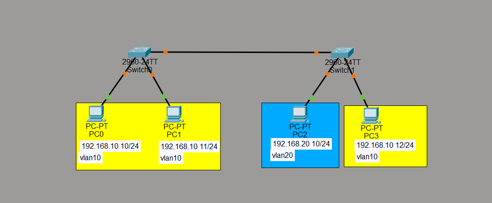

# VLAN Configuration and Trunking Between Two Switches

## 1. Project Overview

This project is part of my networking learning journey using **Cisco Packet Tracer**.

In this lab, I practiced creating VLANs and configuring trunk ports between two Cisco 2960 switches.

The main goal is to understand how VLANs separate devices into different network groups and how devices in the same VLAN can communicate even when they are connected to different switches.

## 2. Lab Objectives

In this lab, I wanted to learn how to:

- Create and configure VLANs.
- Assign switch ports to specific VLANs.
- Configure access ports for end devices.
- Configure trunk links between two switches.
- Understand how VLANs work across multiple switches.
- Verify VLAN and trunk configurations.

## 3. Network Topology

The network consists of:

- 2 Cisco Catalyst 2960 switches.
- 4 PCs.
- 2 VLANs (VLAN 10 and VLAN 20).
- Trunk connections between the two switches.

### Topology Diagram

## 4. IP Addressing and VLAN Assignment

Each PC is assigned to a VLAN based on its department.

| Device | Switch | VLAN | IP Address |
|---|---|---|---|
| PC0 | SW1 | VLAN 10 | 192.168.10.10/24 |
| PC1 | SW1 | VLAN 10 | 192.168.10.11/24 |
| PC2 | SW2 | VLAN 20 | 192.168.20.10/24 |
| PC3 | SW2 | VLAN 10 | 192.168.10.12/24 |

### VLAN Information

| VLAN ID | VLAN Name | Network |
|---|---|---|
| 10 | Keuangan | 192.168.10.0/24 |
| 20 | Engineering | 192.168.20.0/24 |

## 5. Configuration Overview

Two switches were configured in this lab.

**SW1:**
- Created VLAN 10 (Keuangan).
- Created VLAN 20 (Engineering).
- Assigned FastEthernet 0/1–0/2 to VLAN 10.
- Configured GigabitEthernet 0/1–0/2 as trunk ports.

**SW2:**
- Created VLAN 10 (Keuangan).
- Created VLAN 20 (Engineering).
- Assigned FastEthernet 0/1 to VLAN 20.
- Assigned FastEthernet 0/2 to VLAN 10.
- Configured GigabitEthernet 0/1–0/2 as trunk ports.

The complete configurations are available here:

- [SW1 Configuration](configurations/SW1-configuration.txt)
- [SW2 Configuration](configurations/SW2-configuration.txt)

## 6. Understanding What I Learned

**What is a VLAN?**

A VLAN (Virtual Local Area Network) is used to divide a physical network into separate logical networks.

For example, VLAN 10 is used for the Finance department, while VLAN 20 is used for the Engineering department.

**What is an Access Port?**

An access port connects an end device, such as a PC, to a specific VLAN.

**What is a Trunk Port?**

A trunk port connects switches and carries traffic from multiple VLANs through the same physical link.

This allows devices in the same VLAN to communicate even when they are connected to different switches.

## 7. Network Verification

After completing the configuration, I will use the following commands to check the network:

| Command | Purpose |
|---|---|
| `show vlan brief` | Check VLANs and assigned ports. |
| `show interfaces trunk` | Check trunk port status. |
| `show spanning-tree` | Check Spanning Tree Protocol information. |

I will also use the `ping` command to test connectivity between PCs in the same VLAN.

The test results and observations will be documented in:

[View Network Verification](verification.md)

## 8. What I Learned

Through this lab, I learned that:

- VLANs help separate devices into different logical networks.
- Access ports connect end devices to specific VLANs.
- Trunk ports allow multiple VLANs to communicate across switches.
- Devices in the same VLAN can communicate even when connected to different switches.
- Network configuration should always be followed by verification and testing.

## 9. Tools Used

- Cisco Packet Tracer
- Cisco Catalyst 2960 Switch
- PC End Devices

## 10. Learning Status

This project is part of my ongoing journey to understand networking fundamentals and build practical skills for my future in cybersecurity.

**More labs and network configurations will be added as I continue learning.**
