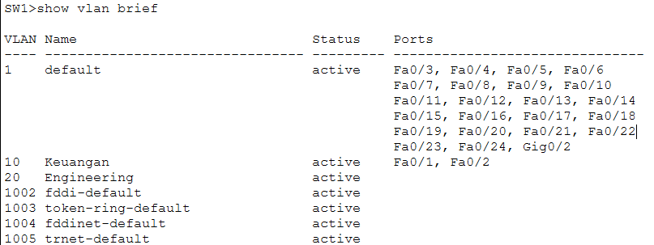
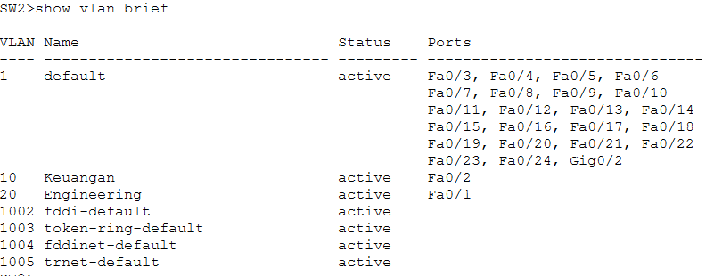
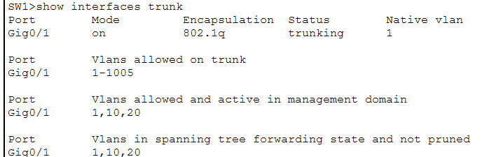
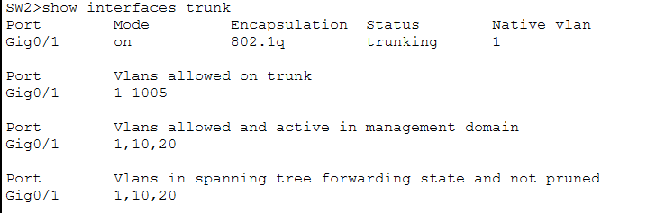
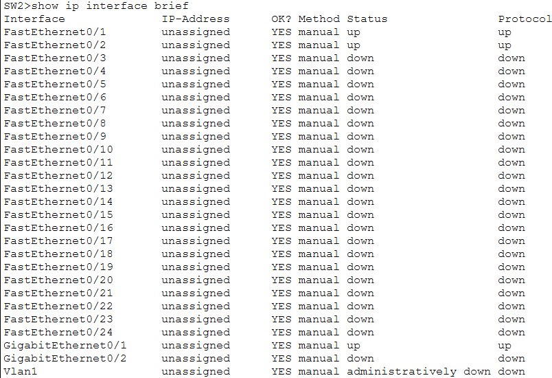
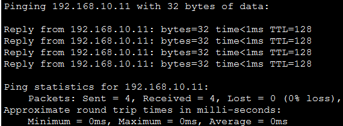
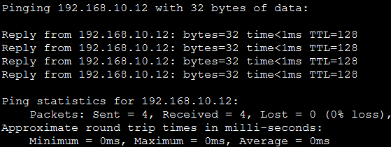
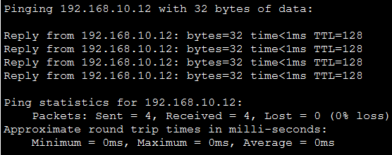
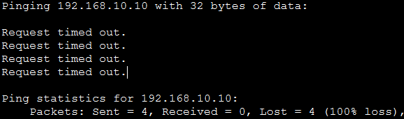
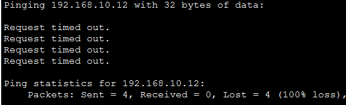

# Network Verification

## 1. Overview

This document contains the verification results of the VLAN and trunk configuration in Cisco Packet Tracer.

The verification process checks:
- VLAN creation and port assignment.
- Trunk port status.
- Network interface status.
- Connectivity between PCs.

## 2. VLAN Verification

**Command:**

### SW1 VLAN Verification




### SW1 Results

| VLAN ID | VLAN Name | Status | Assigned Ports |
|---|---|---|---|
| 10 | Keuangan | Active | Fa0/1, Fa0/2 |
| 20 | Engineering | Active | No access ports assigned |

**Result:** VLAN 10 and VLAN 20 were successfully created on SW1. The access ports Fa0/1 and Fa0/2 were assigned to VLAN 10.

### SW2 Results

### SW2 VLAN Verification


## 3. Trunk Port Verification

At this stage, I verified the trunk port configuration on both SW1 and SW2 using the `show interfaces trunk` command. This verification ensures that the trunk links are operating correctly and allowing VLAN traffic to pass between switches.

### SW1 Results

**Command:**

```bash
show interfaces trunk
```

**Output Summary:**

| Port | Mode | Encapsulation | Status | Native VLAN |
|---|---|---|---|---|
| Gig0/1 | On | 802.1Q | Trunking | 1 |

| Verification | Result |
|---|---|
| VLANs Allowed | 1-1005 |
| VLANs Allowed and Active | 1, 10, 20 |
| VLANs in Spanning Tree Forwarding State | 1, 10, 20 |

**Verification Result:**

GigabitEthernet0/1 is successfully operating as a trunk port. VLANs 1, 10, and 20 are active and forwarding traffic.

**SW1 Verification Evidence:**



---

### SW2 Results

**Command:**

```bash
show interfaces trunk
```

**Output Summary:**

| Port | Mode | Encapsulation | Status | Native VLAN |
|---|---|---|---|---|
| Gig0/1 | On | 802.1Q | Trunking | 1 |

| Verification | Result |
|---|---|
| VLANs Allowed | 1-1005 |
| VLANs Allowed and Active | 1, 10, 20 |
| VLANs in Spanning Tree Forwarding State | 1, 10, 20 |

**Verification Result:**

GigabitEthernet0/1 is successfully operating as a trunk port. VLANs 1, 10, and 20 are active and forwarding traffic.

**SW2 Verification Evidence:**



---

### Overall Verification

Both SW1 and SW2 have successfully established trunk connections through GigabitEthernet0/1 using IEEE 802.1Q encapsulation.

The verification results confirm that:

- Both trunk ports are in the **Trunking** state.
- The Native VLAN is configured as **VLAN 1**.
- VLANs **1, 10, and 20** are allowed and active.
- VLANs **1, 10, and 20** are in the Spanning Tree Forwarding State.

These results confirm that the trunk links are functioning correctly and are ready to carry traffic between switches.
## 4. Interface Status Verification

At this stage, I checked the operational status of the switch interfaces using the `show ip interface brief` command.

### SW2 Results

**Command:**

```bash
show ip interface brief
```

**Output Summary:**

| Interface | Status | Protocol |
|---|---|---|
| Fa0/1 | Up | Up |
| Fa0/2 | Up | Up |
| Gig0/1 | Up | Up |
| Gig0/2 | Down | Down |

**Verification Evidence:**



**Result:**

Gig0/1 is active, while Gig0/2 has no active physical connection. Fa0/1 and Fa0/2 are also operational, with both their interface status and line protocol showing Up.

The results confirm that the listed interfaces are operating as expected based on their physical connection status.

## 5. Connectivity Testing

Connectivity testing was performed to verify communication between devices within the same VLAN and between different VLANs.

The tests were conducted using the `ping` command in Cisco Packet Tracer to verify network connectivity across SW1 and SW2.

### 5.1 Network Connectivity Test Results

| No. | Source | Destination | Expected Result | Actual Result |
|---|---|---|---|---|
| 1 | PC0 (VLAN 10) | PC1 (VLAN 10) | Successful | Successful |
| 2 | PC0 (VLAN 10) | PC3 (VLAN 10) | Successful | Successful |
| 3 | PC1 (VLAN 10) | PC3 (VLAN 10) | Successful | Successful |
| 4 | PC2 (VLAN 20) | PC0 (VLAN 10) | Failed | Failed |
| 5 | PC2 (VLAN 20) | PC3 (VLAN 10) | Failed | Failed |

### 5.2 Ping Command

The following command was used to test connectivity between devices:

```bash
ping [Destination IP Address]
```

### 5.3 Connectivity Test Evidence

**Test 1 – PC0 to PC1 (VLAN 10)**

Both devices are connected to SW1 and belong to VLAN 10. The ping test confirms successful communication within the same VLAN and switch.



**Test 2 – PC0 to PC3 (VLAN 10)**

PC0 and PC3 belong to VLAN 10 but are connected to different switches. The successful ping confirms that VLAN 10 traffic can pass through the trunk link between SW1 and SW2.



**Test 3 – PC1 to PC3 (VLAN 10)**

Both devices belong to VLAN 10 and are connected to different switches. The successful ping further confirms connectivity across the trunk link.



**Test 4 – PC2 to PC0 (VLAN 20 to VLAN 10)**

PC2 belongs to VLAN 20, while PC0 belongs to VLAN 10. The ping test fails because inter-VLAN routing has not been configured.



**Test 5 – PC2 to PC3 (VLAN 20 to VLAN 10)**

PC2 and PC3 belong to different VLANs. The ping test fails because devices in different VLANs require inter-VLAN routing to communicate.



### 5.4 Overall Verification

The connectivity tests confirm the following:

- Devices within VLAN 10 can communicate successfully on the same switch.
- Devices within VLAN 10 can communicate across different switches through the trunk link.
- Devices in VLAN 10 and VLAN 20 cannot communicate because inter-VLAN routing has not been configured.

These results demonstrate that VLAN segmentation and trunk configuration are functioning as expected in the network topology.

## 6. Verification Summary

Based on the initial verification:

- VLAN 10 and VLAN 20 were created successfully on SW1.
- SW1 access port assignments were verified.
- SW2 Gig0/1 was confirmed to be operating as a trunk.
- SW2 Gig0/2 is currently down.
- PC connectivity testing has not been completed.

## 7. Learning Notes

Through this lab, I learned how to:

- Create VLANs on Cisco switches.
- Assign access ports to specific VLANs.
- Configure trunk ports using IEEE 802.1Q.
- Verify VLAN and interface status using Cisco IOS commands.

**Project Status:** In Progress
